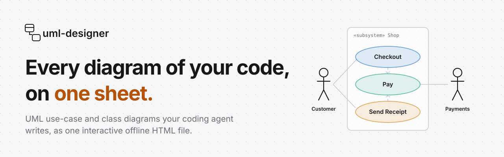
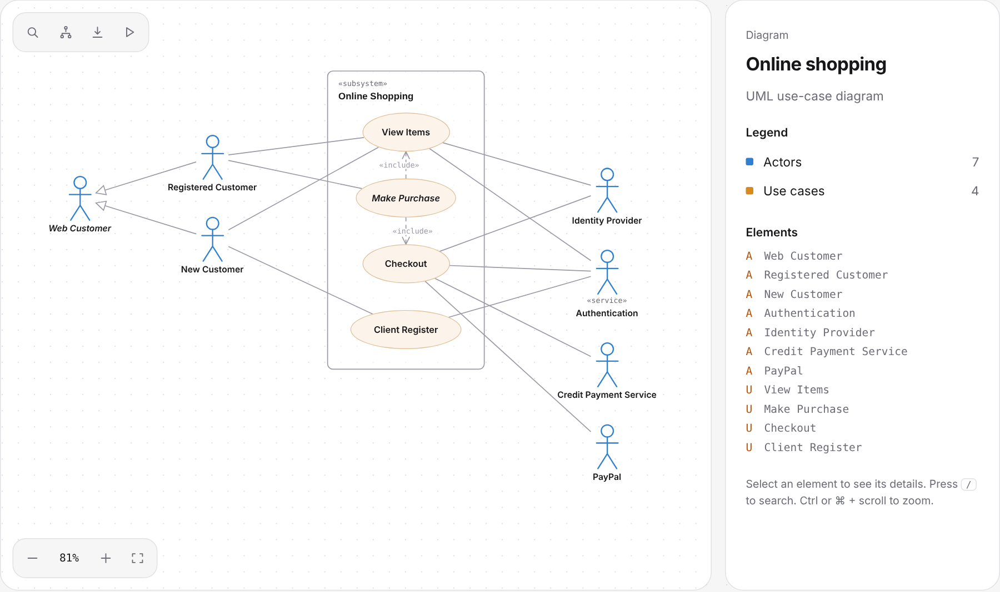
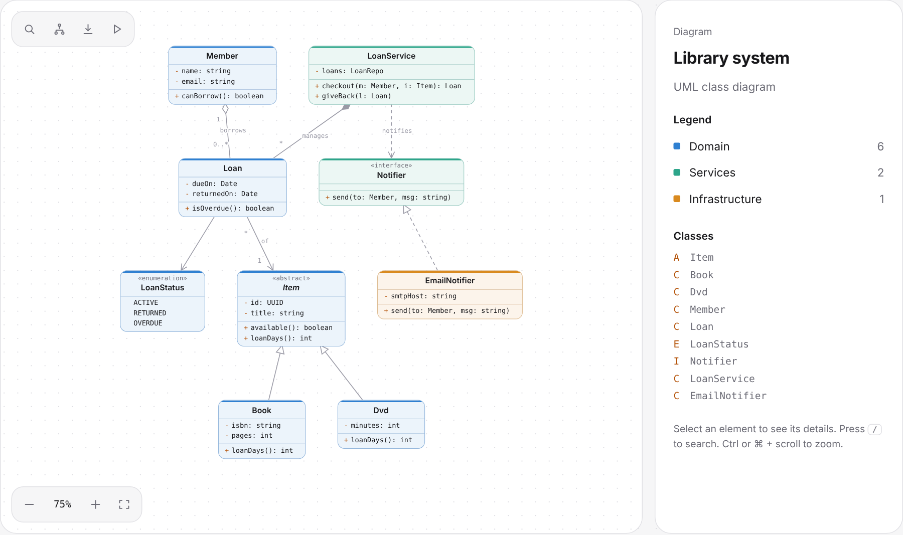

<p align="center">
  <picture>
    <source media="(prefers-color-scheme: dark)" srcset="assets/brand/header-dark.svg">
    
  </picture>
</p>

<p align="center">
  <a href="https://github.com/ritsukasu/UML-Designer/actions/workflows/ci.yml"></a>
  <a href="LICENSE"></a>
  
  
</p>

<p align="center">
  <a href="https://ritsukasu.github.io/UML-Designer/">Live workspace</a> · <a href="#the-diagram-formats">Formats</a> · <a href="examples/">Examples</a> · <a href="AGENTS.md">Agent instructions</a>
</p>

Ask your coding agent to diagram a feature, a domain or a codebase. It writes a small typed JSON, uml-designer validates it and names every fix, lays it out, and delivers one self-contained HTML viewer. No server, no account, no coordinates to place by hand, and nothing to install to open the result.

Two kinds of diagram: **use-case** (actors, use cases, a system boundary, `«include»`, `«extend»` and generalization) and **class** (classes, interfaces, enums, inheritance, composition, aggregation and packages).

<p align="center">
  <picture>
    <source media="(prefers-color-scheme: dark)" srcset="assets/readme/usecase-dark.png">
    
  </picture>
</p>

## Quick start

Requires Node 18 or later. There is nothing to install.

```bash
git clone https://github.com/ritsukasu/UML-Designer.git
cd UML-Designer
node bin/uml.mjs deliver examples/online-shopping.json --open
```

That validates the example, writes `examples/online-shopping.html` and opens it in your browser. The file opens in any browser later too, offline.

To work with a coding agent, point it at [`AGENTS.md`](AGENTS.md), then ask:

> Make a UML use-case diagram of this app's checkout flow.

The agent writes `.uml/<name>/diagram.json`, validates and repairs it, and delivers `.uml/<name>/diagram.html`. To change the diagram, ask again: the agent edits the JSON and delivers it again.

You can also open [`web/index.html`](web/index.html) directly. It is the workspace: paste JSON into the editor and the diagram updates as you type.

## The viewer

<p align="center">
  <picture>
    <source media="(prefers-color-scheme: dark)" srcset="assets/readme/class-dark.png">
    
  </picture>
</p>

- **Explore:** select a node to light its connections and dim the rest, with its details and relations in the inspector. **Hierarchy** follows inheritance or generalization up and down.
- **Find:** search ids, labels and members. The legend toggles whole packages or actor groups on and off.
- **Guided views:** tabs the agent defines, like "Purchase flow", that focus one part of the diagram. **Present** steps through them full screen with the arrow keys.
- **Edit:** drag nodes to rearrange, pan and zoom, and fix the JSON in the built-in editor with live diagnostics. **Auto-layout** resets positions.
- **Export:** PlantUML, Mermaid or JSON from the viewer, or from the CLI.
- **Keyboard:** `/` search, `H` hierarchy, `E` editor, `F` present, `Esc` clear, Ctrl or ⌘ and scroll to zoom.
- **Themes:** dark and light, and animations respect reduced motion.

## The diagram formats

### Use-case diagram

```json
{
  "type": "usecase",
  "title": "Online shop",
  "system": "Shop",
  "actors": [
    { "id": "Customer", "label": "Customer" },
    { "id": "Payments", "label": "Payment Service", "stereotype": "service", "side": "right" }
  ],
  "usecases": [
    { "id": "Checkout", "label": "Checkout" },
    { "id": "Pay", "label": "Pay" },
    { "id": "Receipt", "label": "Send Receipt" }
  ],
  "relations": [
    { "from": "Customer", "to": "Checkout", "type": "associates" },
    { "from": "Checkout", "to": "Pay", "type": "include" },
    { "from": "Receipt", "to": "Pay", "type": "extend" },
    { "from": "Payments", "to": "Pay", "type": "associates" }
  ]
}
```

<div align="center">

| Relation | Goes from → to | Drawn as |
| :-- | :-- | :-- |
| `associates` | actor → use case | plain line |
| `include` | use case → the use case it includes | dashed arrow, `«include»` |
| `extend` | extending use case → base use case | dashed arrow, `«extend»` |
| `generalizes` | child → parent (two actors or two use cases) | hollow triangle at the parent |

</div>

- **Actors** sit on `"side": "left"` (default) or `"right"`. Put people on the left and external systems on the right. Generalized actors nest toward the system.
- **Optional fields:** `abstract` (italic name), `stereotype` (`«name»` above the label), `usecases[].col` (column inside the boundary; extending use cases default to column 1), `system` and `stereotype` on the diagram (the boundary's name and label).
- **Views** are `{ "id", "label", "nodes": [ids] }` and become tabs.

### Class diagram

```json
{
  "title": "Library",
  "packages": [{ "id": "domain", "label": "Domain" }],
  "classes": [
    { "id": "Item", "kind": "abstract", "package": "domain",
      "attributes": ["- title: string"], "methods": ["+ loanDays(): int"] },
    { "id": "Book", "package": "domain", "attributes": ["- isbn: string"] }
  ],
  "relations": [{ "from": "Book", "to": "Item", "type": "inherits" }]
}
```

- **Kinds:** `class` (default), `abstract`, `interface`, `enum`.
- **Relations:** `inherits`, `implements`, `composes`, `aggregates`, `associates`, `depends`, each with optional `fromMult`, `toMult` and `label`.
- **Members** are strings that start with a visibility marker: `+ - # ~`.
- **No coordinates:** uml-designer lays everything out, layered by inheritance and ordered to reduce crossings.

Ready-made starters are in [`examples/`](examples/).

## The CLI

The agent runs the CLI for you, and it works on its own too:

```bash
node bin/uml.mjs validate diagram.json                               # diagnostics with fixes; exit 1 on errors
node bin/uml.mjs deliver  diagram.json [--out out.html] [--open]     # validate → layout → one offline HTML file
node bin/uml.mjs export   diagram.json --format puml|mmd             # PlantUML or Mermaid source
node bin/uml.mjs init     [class|usecase] [file]                     # write a starter diagram.json
```

- **validate** lists every problem with a code and the allowed fixes, and exits `1` when the diagram has errors, so it works in CI and in agent loops. For example:

  ```text
    error  unknown-node
      relations[0].to "Chekout" is not an actor or use case. Use one of: Customer, Checkout, Pay.
    ✗ 1 error
  ```

- **deliver** embeds the diagram in the viewer and writes one HTML file. The same JSON always gives the same file.
- **export** prints PlantUML or Mermaid. Mermaid has no use-case type, so use-case diagrams export as a flowchart.

## Development

No build step and no dependencies. The viewer is a single file, `web/index.html`.

```bash
npm test         # every example, the CLI, the exporters and the viewer script
npm run demo     # build and open the online-shopping example
```

The validator and exporters sit between the `/*core*/` and `/*end-core*/` markers in `web/index.html`, and the CLI loads that same block, so the browser and the terminal always agree.

```text
bin/uml.mjs      CLI: validate, deliver, export, init
web/index.html   viewer, workspace and landing page
examples/        starter diagrams
test/            node:test suite
AGENTS.md        how a coding agent should use the tool
```

## License

[MIT](LICENSE).
